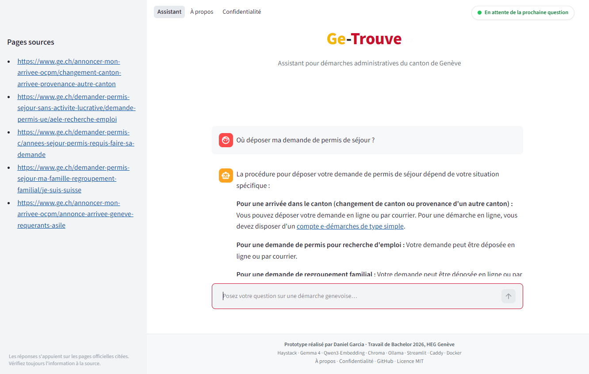
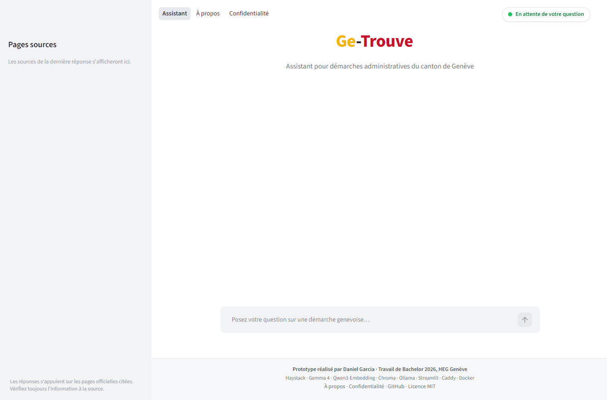
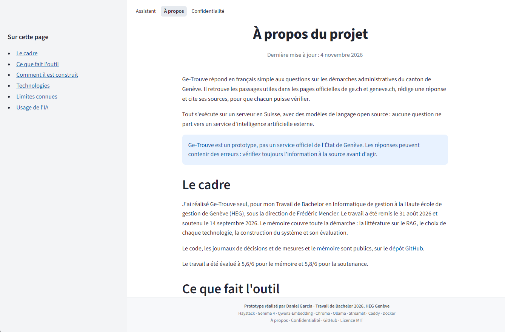
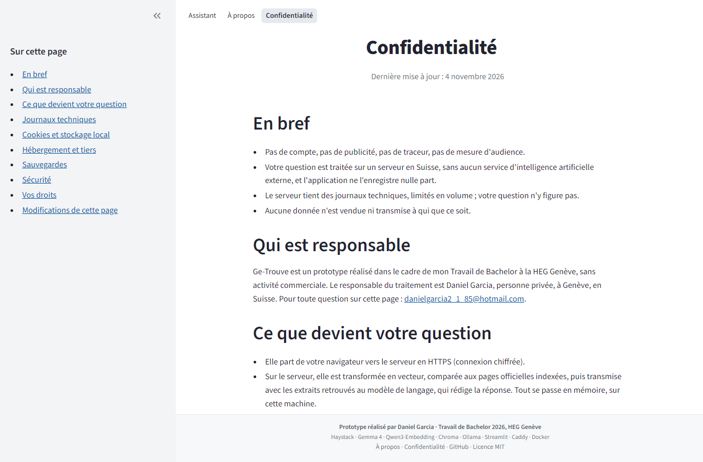
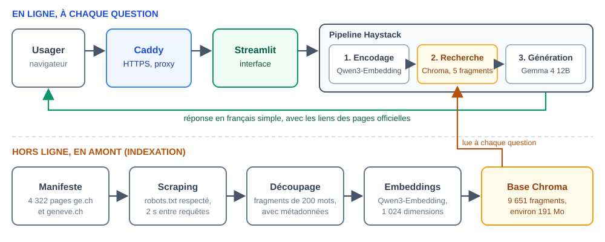
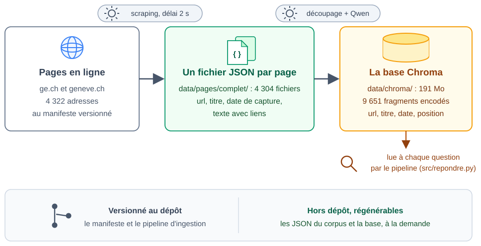
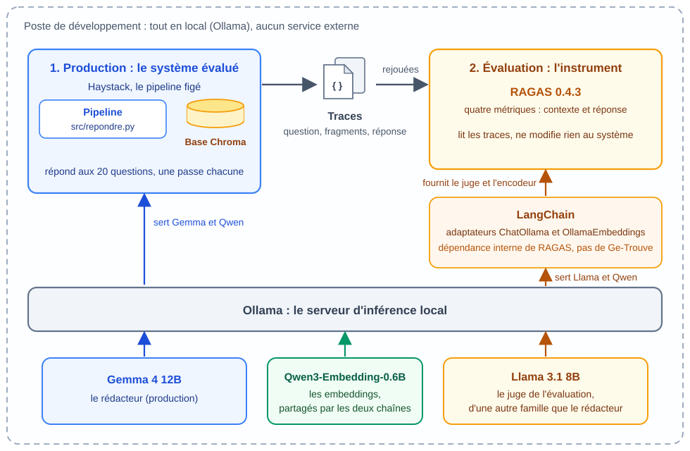
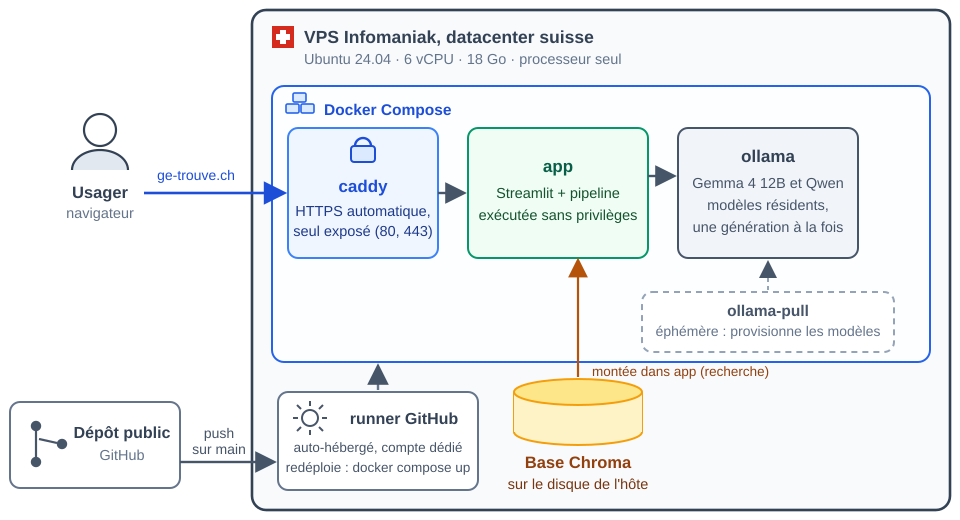

<p align="center">
  
</p>

<p align="center">
  <em>Assistant conversationnel RAG en français pour les démarches administratives du canton de Genève,
  exécuté entièrement sur un serveur suisse.</em>
</p>

<p align="center">
  <a href="https://github.com/DanielGarcia85/ge-trouve-ch/actions/workflows/deploy.yml"></a>
  <a href="LICENSE"></a>
  
  
  
  
  
  <a href="https://ge-trouve.ch"></a>
</p>

<p align="center">
  <a href="https://ge-trouve.ch">Service en ligne</a> ·
  <a href="#fonctionnalités">Fonctionnalités</a> ·
  <a href="#architecture">Architecture</a> ·
  <a href="#schémas">Schémas</a> ·
  <a href="#résultats-de-lévaluation">Résultats</a> ·
  <a href="#démarrer-en-local">Démarrer en local</a>
</p>

Ge-Trouve répond en français simple aux questions sur les démarches administratives du canton de
Genève. Il retrouve les passages utiles dans les pages officielles de [ge.ch](https://ge.ch/) et [geneve.ch](https://www.geneve.ch/), rédige une
réponse et cite ses sources, pour que chacun puisse vérifier. Les modèles de langage tournent sur le
serveur du projet, en Suisse : aucune question ne part vers un service d'intelligence artificielle
externe.

<p align="center">
  
</p>

> **Avertissement.** Ge-Trouve est un prototype développé dans le cadre d'un travail de Bachelor. Ce n'est pas un service officiel de l'État de Genève. Les réponses s'appuient sur les pages officielles citées, mais peuvent contenir des erreurs : vérifiez toujours l'information à la source avant d'agir.

---

## Contexte académique

| | |
|---|---|
| **Titre** | Ge-Trouve : Conception, développement et évaluation d'un assistant conversationnel RAG en français pour les démarches administratives du canton de Genève |
| **Type** | Travail de Bachelor |
| **Institution** | Haute école de gestion de Genève (HEG-Genève), filière Informatique de gestion |
| **Auteur** | Daniel Garcia |
| **Directeur de mémoire** | Frédéric Mencier |
| **Remise et soutenance** | 31 août 2026 et 14 septembre 2026 |
| **Évaluation** | mémoire 5,6/6, soutenance 5,8/6 |
| **Mémoire** | [`memoire/TB_Ge-Trouve_DanielGarcia.pdf`](memoire/TB_Ge-Trouve_DanielGarcia.pdf) (version remise, aussi jointe à la [release `v1.0.0`](https://github.com/DanielGarcia85/ge-trouve-ch/releases/tag/v1.0.0)) ; source `.docx` dans `memoire/` |

Le mémoire est le document écrit qui accompagne ce dépôt : il développe toute la démarche, de la revue de la littérature RAG et des choix de technologies jusqu'à la construction du système et à son évaluation. Ce dépôt en est la réalisation logicielle.

**Question de recherche :** dans quelle mesure un système RAG appliqué à des documents administratifs en français produit-il des réponses fiables et pertinentes pour des utilisateurs non-experts ?

## Pourquoi Ge-Trouve

L'information administrative genevoise est publique, mais dispersée sur des milliers de pages et rédigée dans une langue administrative. Pour un usager qui ne sait pas où chercher (personnes âgées, nouveaux arrivants), l'accès reste difficile. Ge-Trouve accepte une question en langage courant (« Où déposer ma demande de permis de séjour ? »), retrouve les passages pertinents dans les pages officielles indexées, puis rédige une réponse simple qui cite ses sources, pour que chacun puisse vérifier.

À ce jour, aucun assistant conversationnel destiné aux citoyens genevois n'a pu être identifié. Le précédent le plus proche est le [chatbot IA de fr.ch](https://www.fr.ch/le-chatbot-ia-de-frch), lancé par le canton de Fribourg en mars 2026 : un assistant voisin, qui interroge les sources officielles du canton et cite ses sources, mais couvre Fribourg et non Genève.

## Fonctionnalités

- Questions en français courant, tous registres (« C'est où pour échanger mon permis ? »)
- Réponses rédigées uniquement à partir des pages officielles indexées, avec liens cliquables
- Pages sources de chaque réponse affichées dans la barre latérale
- Refus explicite (« je ne sais pas ») quand la question sort du corpus, avec orientation
- Affichage de la réponse en *streaming*, mot à mot
- Message clair en français si le service ne peut pas répondre
- Pages « À propos » (le projet, sa construction, ses technologies) et « Confidentialité » (ce que le site fait réellement des données)
- Aucune donnée d'usager ne quitte le serveur ; aucun compte, aucun historique conservé

<details>
<summary><b>Plus de captures</b> (cliquer pour déplier)</summary>

La page au repos, avant toute question :



La page « À propos » : le cadre du travail, le fonctionnement, les technologies, avec un sommaire dans la barre latérale :



La page « Confidentialité » : ce que le site fait réellement des questions, des journaux et des cookies :



</details>

## Pile technique

| Composant | Choix | Version | Rôle |
|---|---|---|---|
| Langage | Python | 3.13 | Socle du projet |
| Framework RAG | [Haystack](https://haystack.deepset.ai/) (`haystack-ai`) | 3.0.0 | Assemblage explicite du pipeline |
| Intégrations | `ollama-haystack`, `chroma-haystack` | 6.8.0, 4.4.0 | Connecteurs Ollama et Chroma |
| Serveur de modèles | [Ollama](https://ollama.com/) | 0.32.6 (production) | Exécution locale des modèles |
| LLM (rédacteur) | [Gemma 4 12B Instruct](https://huggingface.co/google/gemma-4-12B-it) (`gemma4:12b`) | Q4_K_M, 7,6 Go | Génération des réponses, mode direct (`think:false`) |
| Embeddings | [Qwen3-Embedding-0.6B](https://huggingface.co/Qwen/Qwen3-Embedding-0.6B) (`qwen3-embedding:0.6b`) | Q8_0, 639 Mo | Vecteurs de 1 024 dimensions |
| LLM (repli et juge) | [Llama 3.1 8B Instruct](https://huggingface.co/meta-llama/Llama-3.1-8B-Instruct) (`llama3.1:8b`) | Q4_K_M, 4,9 Go | Repli documenté ; juge d'évaluation (hors production) |
| Base vectorielle | [Chroma](https://www.trychroma.com/) | embarquée | Stockage et recherche des fragments, filtrage par métadonnées |
| Extraction | [Trafilatura](https://trafilatura.readthedocs.io/) | 2.2.0 | Texte des pages officielles, liens conservés |
| Interface | [Streamlit](https://streamlit.io/) | 1.62.0 | Conversation, pages « À propos » et « Confidentialité » |
| Serveur frontal | [Caddy](https://caddyserver.com/) | 2 | HTTPS automatique (Let's Encrypt), reverse proxy |
| Conteneurisation | Docker Compose | | Quatre services (voir Déploiement) |
| Évaluation | [RAGAS](https://docs.ragas.io/) + LangChain-Ollama | 0.4.3 | Métriques RAG, juge local (machine de développement uniquement) |

Les bibliothèques et les deux modèles de production sont sous licences permissives (Apache 2.0, MIT). Llama 3.1, utilisé seulement comme juge d'évaluation hors production, relève de la *Llama 3.1 Community License* de Meta. Versions épinglées dans `requirements.txt`.

## Architecture

<p align="center">
  
</p>

- **En ligne, à chaque question** : l'usager atteint le serveur en HTTPS ; Caddy relaie vers l'interface Streamlit, qui appelle directement le pipeline Haystack. La question est encodée par Qwen, Chroma renvoie les cinq fragments les plus proches, et Gemma rédige la réponse à partir de ces seuls extraits.
- **Hors ligne, en amont** : les pages listées au manifeste sont aspirées, découpées en fragments de 200 mots, encodées et rangées dans Chroma, avec leur adresse et leur date de capture.
- Tout s'exécute sur une seule machine. En production comme au développement, aucun appel n'est émis vers un service d'intelligence artificielle externe.
- Chaque question est traitée seule : le modèle ne reçoit que la question courante et ses extraits.

## Schémas

Dans [`docs/schemas/`](docs/schemas), en versions compactes des figures du mémoire.

| Schéma | Ce qu'il montre |
|---|---|
| [Architecture](docs/schemas/architecture.svg) | Les deux chaînes : la réponse en ligne et l'indexation hors ligne. |
| [Production](docs/schemas/production.svg) | Les quatre conteneurs sur le serveur suisse, le seul point exposé, la livraison par le runner. |
| [Indexation](docs/schemas/indexation.svg) | Ce que la chaîne d'indexation crée sur la machine : un JSON par page, puis la base Chroma. |
| [Évaluation](docs/schemas/evaluation.svg) | Le banc RAGAS : le pipeline figé produit les traces, un juge local les note. |

## Corpus et sources de données

Le corpus couvre les démarches administratives des deux administrations genevoises :

- **[ge.ch](https://ge.ch/)** : catalogue officiel des démarches de l'État, pages pratiques (contacts, horaires, adresses) et pages publiques des e-démarches ;
- **[geneve.ch](https://www.geneve.ch/)** : démarches de la Ville de Genève.

Le périmètre pourra être étendu si besoin.

Chiffres du corpus indexé : **4 322 pages** au manifeste (4 304 aspirées), **9 651 fragments** de 200 mots (recouvrement 40), vecteurs de 1 024 dimensions, base Chroma d'environ 191 Mo. Chaque fragment porte ses métadonnées (adresse, titre, date de capture, position) pour la traçabilité des réponses ; les hyperliens sont préservés à l'extraction, ce qui permet de citer un guichet en ligne ou un formulaire directement dans la réponse.

Le scraping respecte le `robots.txt` de chaque domaine, s'identifie par un agent dédié (`GeTrouveBot`) et applique un délai de politesse de deux secondes entre chaque requête. Le corpus brut n'est pas versionné : il se régénère à la demande depuis le manifeste.

<details>
<summary><b>Schéma : la chaîne d'indexation</b> (cliquer pour déplier)</summary>



</details>

## Résultats de l'évaluation

Protocole : vingt questions genevoises écrites à la main (seize avec réponse attendue, quatre volontairement hors périmètre), quatre métriques RAGAS calculées en local (juge Llama 3.1 8B, d'une autre famille que le rédacteur), contrôle humain à l'aveugle sur un quart des réponses.

| Métrique | Moyenne (16 questions avec réponse) |
|---|---|
| Précision du contexte | 0,92 |
| Rappel du contexte | 0,93 |
| Fidélité | 0,85 |
| Pertinence de la réponse | 0,71 |

Constats principaux : la recherche documentaire est le point fort ; aucune invention pure n'a été observée (les erreurs de fidélité sont des fusions de passages voisins) ; la pertinence souffre de réponses trop longues ; le refus hors périmètre a fonctionné sur trois questions sur quatre. Analyse complète au chapitre 12 du mémoire ; scores détaillés et traces dans `resultats/evaluation/`.

<details>
<summary><b>Schéma : le banc d'évaluation</b> (cliquer pour déplier)</summary>



</details>

## Démarrer en local

### Prérequis

- Python 3.13
- [Ollama](https://ollama.com/download) installé et lancé (version 0.32 ou plus récente)
- Environ 16 Go de RAM libres pour le confort (Gemma + Qwen chargés occupent ~11,3 Go)

### Installation

```bash
git clone https://github.com/DanielGarcia85/ge-trouve-ch.git
cd ge-trouve-ch

python -m venv .venv
# Windows : .venv\Scripts\activate
source .venv/bin/activate

pip install -r requirements.txt
```

### Modèles

```bash
ollama pull gemma4:12b
ollama pull qwen3-embedding:0.6b
ollama pull llama3.1:8b   # facultatif : repli et juge d'évaluation
```

### Construire l'index

La base vectorielle n'est pas versionnée : elle se reconstruit depuis un **manifeste des sources**, un fichier CSV qui liste les URL officielles à aspirer et leur date de capture (`src/scraping/manifeste_sources.csv`).

Ce manifeste se prépare avec les outils de `scripts/scraping/` : `verifier_robots.py` (respect des `robots.txt`), `decouvrir_sitemap.py` (collecte des URL depuis les sitemaps) et `lister_souspages_chapeau.py` (sous-pages des pages chapeau) ; la démarche est décrite dans `scripts/scraping/decouverte_corpus.md`.

Une fois le manifeste en place, deux commandes reconstruisent tout :

```bash
python src/scraping/scrape_complet.py     # aspire les pages listées au manifeste (~2,5 h, délai de politesse inclus)
python src/indexing/indexer_complet.py    # découpage, embeddings, écriture Chroma (~3,3 h sur CPU)
```

L'ingestion est idempotente et reprend où elle s'est arrêtée en cas d'interruption. Le guide pas à pas complet est dans [`docs/reconstruire_la_base.md`](docs/reconstruire_la_base.md).

### Lancer l'assistant

```bash
streamlit run src/app/app.py
```

L'application s'ouvre dans le navigateur, sur la page « Assistant » ; les pages « À propos » et « Confidentialité » sont dans la navigation en haut. Le tout premier appel charge les modèles en mémoire (compter une à deux minutes par réponse) ; les réglages (modèles, top-k, échantillonnage) se lisent dans `src/config.py` et se surchargent par variables d'environnement.

## Déploiement en production

<details>
<summary><b>Schéma : la production</b> (cliquer pour déplier)</summary>



</details>

La production tourne sur un serveur virtuel suisse (Infomaniak, 6 vCPU / 18 Go, Ubuntu 24.04, processeur seul), orchestrée par Docker Compose (`deploy/docker-compose.yml`) en quatre services :

| Service | Rôle |
|---|---|
| `ollama` | Sert les modèles, gardés résidents en mémoire (`keep_alive`) |
| `ollama-pull` | Éphémère : télécharge les modèles à la première mise en route |
| `app` | Interface Streamlit + pipeline, exécutée sans privilèges |
| `caddy` | Seul service exposé : HTTPS automatique et reverse proxy (`deploy/Caddyfile`) |

```bash
docker compose -f deploy/docker-compose.yml up -d --build
```

- La base Chroma est construite en local puis copiée sur le serveur : rien ne se re-scrape depuis le VPS.
- Une seule génération à la fois est autorisée (`OLLAMA_NUM_PARALLEL=1`, garde-fou mémoire).
- Aucun fichier de secrets : la configuration vit dans l'environnement.
- Streamlit est lancé avec l'adresse publique du site (sinon il interroge un service externe au démarrage pour deviner l'adresse IP du serveur) et sans afficher le détail des erreurs aux visiteurs ; les journaux des conteneurs sont limités en taille.
- Je travaille sur la branche `develop` ; `main` est ce qui tourne en production. Chaque poussée sur `main` qui touche le code ou la configuration déclenche un redéploiement par un *runner* GitHub Actions auto-hébergé sur le serveur (`.github/workflows/deploy.yml`) ; seules les poussées directes déploient, jamais les contributions externes.

## Structure du dépôt

```
ge-trouve-ch/
├── src/
│   ├── app/                     # interface Streamlit
│   │   ├── app.py               # point d'entrée : configuration, navigation, pied de page
│   │   ├── commun.py            # éléments partagés (styles, titre et sommaire des pages)
│   │   ├── vues/                # pages : assistant, à propos, confidentialité
│   │   └── assets/              # logos et favicon (SVG, PNG)
│   ├── repondre.py              # pipeline de réponse (point d'entrée)
│   ├── config.py                # configuration centralisée (modèles, réglages)
│   ├── pull_modeles.py          # provisionnement des modèles Ollama
│   ├── scraping/                # manifeste des sources et scrapers
│   ├── indexing/                # découpage, embeddings, écriture Chroma
│   └── generation/              # consignes de génération (versions V0 à V5)
├── scripts/
│   ├── scraping/                # découverte du corpus (sitemap, robots.txt)
│   ├── mesures/                 # bancs de mesure (latence, mémoire, consignes)
│   └── setup/                   # pull des modèles Ollama (PowerShell)
├── evaluation/                  # harnais RAGAS (Partie 3 ; deps : requirements-evaluation.txt)
│   ├── jeu_evaluation.py        # les 20 questions et leurs réponses de référence
│   ├── executer_banc.py         # rejoue le pipeline figé et produit les traces
│   ├── calculer_ragas.py        # notation RAGAS (juge et encodeur locaux)
│   └── verifier_cablage.py      # test de câblage du juge
├── resultats/
│   ├── pilote/                  # journaux et réponses du corpus pilote
│   ├── complet/                 # journaux et réponses du corpus complet
│   ├── interface/               # captures de l'interface
│   ├── consignes/               # réponses archivées des essais de consignes
│   └── evaluation/              # scores RAGAS, traces, contrôle humain
├── deploy/                      # Dockerfile, docker-compose.yml, Caddyfile
├── .streamlit/config.toml       # configuration de l'interface Streamlit
├── .github/workflows/           # déploiement continu (deploy.yml)
├── docs/
│   ├── architecture.md          # documentation technique
│   ├── schemas/                 # schémas du README (SVG)
│   ├── plan_developpement.md    # plan des étapes (Partie 2 et Partie 3)
│   ├── reconstruire_la_base.md  # guide de régénération du corpus et de la base
│   ├── journal_des_decisions.md # une entrée datée par décision
│   └── journal_des_mesures.md   # toutes les mesures, datées et reproductibles
└── memoire/                     # mémoire (docx, PDF), bibliographie (.ris), figures (SVG)
```

## Limites connues

- **Latence** : sur le serveur de production (CPU seul), le premier mot d'une réponse à une question nouvelle apparaît après **90 à 120 secondes** (traitement du prompt), puis la réponse s'écrit en continu. C'est le prix assumé de l'exécution locale souveraine sur un VPS modeste.
- Une seule génération à la fois (contrainte mémoire du palier de serveur).
- Pas de mémoire conversationnelle : chaque question est traitée indépendamment.
- Couverture limitée aux pages HTML du périmètre indexé ; les PDF et formulaires ne sont pas encore ingérés.

## Plan du mémoire

| Partie | Chapitres |
|---|---|
| Introduction | 1. Introduction |
| **Partie 1 : Recherche et choix** | 2. Comprendre le RAG · 3. Choix du framework · 4. Choix du LLM · 5. Choix des embeddings · 6. Choix de la base vectorielle · 7. Évaluation d'un système RAG · 8. RAG en contexte francophone (besoin, existant, positionnement) |
| **Partie 2 : Développement** | 9. Spécifications et architecture · 10. Construction du pipeline · 11. Interface et déploiement |
| **Partie 3 : Évaluation** | 12. Résultats de l'évaluation |
| Conclusion | 13. Conclusion |

## Méthode et traçabilité

Chaque choix technique est instruit dans le mémoire sur sources primaires datées, puis consigné dans le [journal des décisions](docs/journal_des_decisions.md). Chaque mesure (latences, mémoire, débits, scores) est datée et reproductible dans le [journal des mesures](docs/journal_des_mesures.md). La bibliographie complète du mémoire vit dans `memoire/bibliographie/GE-Trouve.ris`.

## Déclaration d'usage de l'IA

Ce projet distingue deux choses :

- **En production, aucun service d'IA externe n'est utilisé** : le modèle de langage est un modèle open source exécuté localement sur le serveur du projet, et aucune donnée d'usager n'en sort.
- **Pendant la fabrication du projet**, Claude (Anthropic) a été utilisé comme assistant à la rédaction du mémoire et, via Claude Code, comme assistant au développement, sous les spécifications de l'auteur. Le contenu, les idées, les choix techniques et leur validation restent entièrement ceux de l'auteur ; chaque décision est consignée dans le journal des décisions.

## Licence

Le **code** de ce dépôt est publié sous licence **MIT**. Les **contenus administratifs indexés** (pages de ge.ch et geneve.ch) restent la propriété de leurs ayants droit, l'État de Genève et la Ville de Genève ; ils ne sont pas redistribués par ce dépôt.

## Citation

```bibtex
@misc{garcia2026getrouve,
  author = {Garcia, Daniel},
  title  = {Ge-Trouve : Conception, développement et évaluation d'un assistant
            conversationnel RAG en français pour les démarches administratives
            du canton de Genève},
  school = {Haute école de gestion de Genève (HEG-GE)},
  year   = {2026},
  note   = {Travail de Bachelor, filière Informatique de gestion},
  url    = {https://github.com/DanielGarcia85/ge-trouve-ch}
}
```
